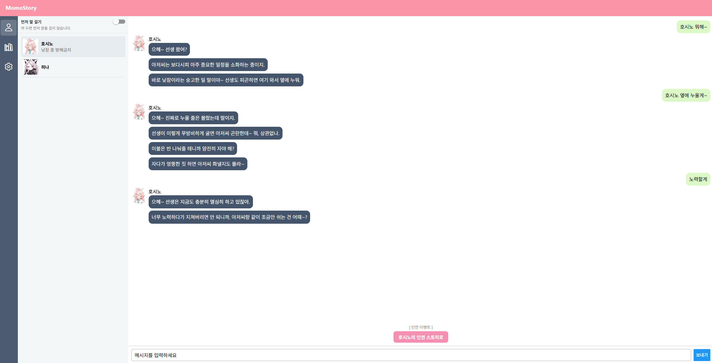
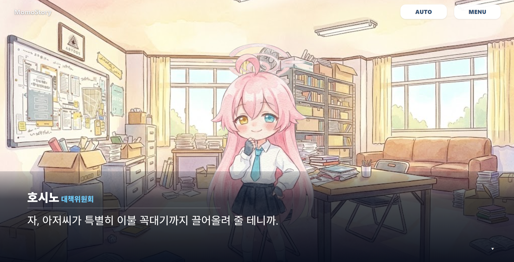

# MomoStory

[한국어](README.md) · [English](README.en.md) · [日本語](README.ja.md) · [简体中文](README.zh-CN.md)

> 블루 아카이브 캐릭터와 대화하고, 대화의 흐름을 인연 이벤트로 이어 가는 비공식 팬 프로젝트입니다.

[](https://github.com/verystrongdeveloper/momoAI/releases/latest)
[](https://github.com/verystrongdeveloper/momoAI/releases/latest)
[](https://expo.dev/)

## 한눈에 보기

<p align="center">
  
</p>

<p align="center"><sub>캐릭터 대화 — 대화가 쌓이면 인연 이벤트를 바로 시작할 수 있습니다.</sub></p>

MomoStory는 캐릭터의 말투와 성격을 반영한 1:1 대화, 그리고 대화 맥락을 바탕으로 전개되는 선택형 인연 이벤트를 제공합니다. 배경·표정·BGM·효과음으로 장면의 분위기까지 함께 즐길 수 있습니다.

<p align="center">
  
</p>

<p align="center"><sub>인연 이벤트 플레이어 — 캐릭터 표정, 배경, 대사와 함께 장면을 재생합니다.</sub></p>

## 주요 기능

| 기능 | 설명 |
| --- | --- |
| 💬 캐릭터 채팅 | 호시노, 히나 등 지원 캐릭터와 페르소나 기반으로 대화합니다. |
| 🎬 인연 이벤트 | 대화 결과를 바탕으로 선택지가 있는 스토리 장면을 생성·재생합니다. |
| 🎵 멀티미디어 연출 | 캐릭터 표정, 배경 이미지, BGM, 효과음으로 이벤트를 구성합니다. |
| 📚 라이브러리 | 채팅과 스토리를 저장하고, 제목/내용 검색·대본 편집·새로 만들기를 지원합니다. 저장된 채팅은 읽기 전용으로 순차 재생합니다. |
| 📹 영상 추출 | 저장된 채팅과 스토리를 16:9 또는 9:16 MP4로 추출합니다. 영상에서는 선택지를 자동으로 진행합니다. |
| 🌐 다국어 | 한국어(기본), English, 日本語, 中文(간체) UI와 해당 언어의 새 채팅·스토리 생성을 지원합니다. 기존 저장본은 자동 번역하지 않습니다. |
| ⚙️ 개인 설정 | 채팅 크기·사운드·언어·API 키를 앱 설정에서 관리합니다. |

## 다운로드

최신 Windows 프로그램과 Android APK는 [GitHub Releases](https://github.com/verystrongdeveloper/momoAI/releases/latest)에서 받을 수 있습니다.

- **Windows**: `MomoStory_*-setup.exe` 설치 파일 또는 `MomoStory.exe`
- **Android**: `MomoStory.apk`

> Android 설치 시 출처를 알 수 없는 앱 설치 허용이 필요할 수 있습니다. Windows 파일은 코드 서명 전까지 SmartScreen 경고가 표시될 수 있습니다.

## 시작하기

### 요구 사항

- Node.js 22.x (22.13.0 이상, 릴리스 CI 기준)
- npm
- Gemini API 키

### 설치 및 실행

```bash
git clone https://github.com/verystrongdeveloper/momoAI.git
cd momoAI
npm install
npx expo start
```

브라우저·Android 에뮬레이터·Expo Go 중 원하는 환경에서 실행할 수 있습니다. 앱을 연 뒤 **설정**에서 본인의 Gemini API 키를 입력하면 대화를 시작할 수 있습니다.

Expo Go에서는 일부 기능을 확인할 수 있지만, Android 네이티브 영상 저장은 개발 빌드 또는 배포 APK가 필요합니다. Windows 빌드에는 Rust와 Windows C++ 빌드 도구, Android 빌드에는 JDK 17 이상과 Android SDK가 필요합니다.

### 배포용 빌드

```bash
# Windows 실행 파일과 설치 파일
npm run desktop

# Android 서명 APK
npm run android:apk
```

Android 릴리스 빌드는 개인 릴리스 키 환경 변수가 필요합니다. GitHub Releases 배포는 태그(`v*`) 푸시 시 GitHub Actions가 자동으로 처리합니다.

서명 및 배포 절차는 [릴리스 안내](docs/RELEASE.md), 영상 추출은 [영상 추출 문서](docs/video-export.md), 생성 언어 동작은 [생성 언어 문서](docs/generation-language.md)를 참고하세요.

## 프로젝트 구조

```text
app/                 Expo Router 화면
components/          채팅 · 이벤트 플레이어 · 레이아웃 UI
constants/           캐릭터와 멀티미디어 에셋 매핑
hooks/               BGM · 레이아웃 · 이벤트 스크립트 처리
services/            AI 호출 · 앱 설정 · 영상 추출
shared/prompts/      채팅 · 스토리 생성 공통 프롬프트
storage/             설정 · API 키 · 라이브러리 저장
server/              Express API (웹 개발용 기본 경로)
src-tauri/           Windows 데스크톱 패키지
.github/workflows/   Windows·Android 릴리스 자동화
```

## 기술 스택

- React Native · Expo · Expo Router · TypeScript
- Tauri · Rust (Windows 데스크톱 패키지)
- Gemini API
- GitHub Actions (Windows EXE / Android APK 릴리스)

## 지원 캐릭터

현재 채팅 화면에서 선택할 수 있는 캐릭터는 **호시노, 히나**입니다.

## 안내 및 권리

MomoStory는 **블루 아카이브를 기반으로 한 비공식·비영리 2차 창작 팬 프로젝트**입니다. 블루 아카이브 및 관련 캐릭터·이미지·음악 등의 권리는 각 권리자에게 있으며, 본 프로젝트는 넥슨 또는 넥슨게임즈와 관련이 없습니다. 상업적 이용을 금합니다.
