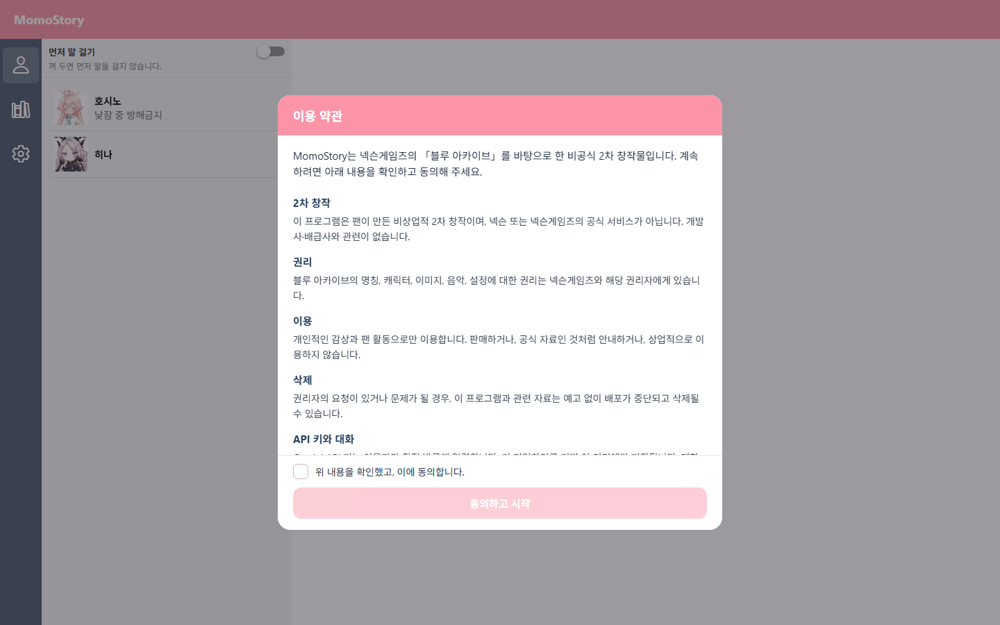

# MomoStory

> 블루 아카이브 캐릭터와 대화하고, 대화의 흐름을 인연 이벤트로 이어 가는 비공식 팬 프로젝트입니다.

[](https://github.com/verystrongdeveloper/momoAI/releases/latest)
[](https://github.com/verystrongdeveloper/momoAI/releases/latest)
[](https://expo.dev/)

## 한눈에 보기

<p align="center">
  
</p>

MomoStory는 캐릭터의 말투와 성격을 반영한 1:1 대화, 그리고 대화 맥락을 바탕으로 전개되는 선택형 인연 이벤트를 제공합니다. 배경·표정·BGM·효과음으로 장면의 분위기까지 함께 즐길 수 있습니다.

## 주요 기능

| 기능 | 설명 |
| --- | --- |
| 💬 캐릭터 채팅 | 호시노, 히나 등 지원 캐릭터와 페르소나 기반으로 대화합니다. |
| 🎬 인연 이벤트 | 대화 결과를 바탕으로 선택지가 있는 스토리 장면을 생성·재생합니다. |
| 🎵 멀티미디어 연출 | 캐릭터 표정, 배경 이미지, BGM, 효과음으로 이벤트를 구성합니다. |
| 🌐 다국어 UI | 한국어(기본), English, 日本語, 中文 인터페이스를 지원합니다. |
| ⚙️ 개인 설정 | 테마·사운드·언어·API 키를 앱 설정에서 관리합니다. |

## 다운로드

최신 Windows 프로그램과 Android APK는 [GitHub Releases](https://github.com/verystrongdeveloper/momoAI/releases/latest)에서 받을 수 있습니다.

- **Windows**: `MomoStory_*-setup.exe` 설치 파일 또는 `MomoStory.exe`
- **Android**: `MomoStory.apk`

> Android 설치 시 출처를 알 수 없는 앱 설치 허용이 필요할 수 있습니다. Windows 파일은 코드 서명 전까지 SmartScreen 경고가 표시될 수 있습니다.

## 시작하기

### 요구 사항

- Node.js 18 이상
- npm
- Gemini API 키

### 설치 및 실행

```bash
git clone https://github.com/verystrongdeveloper/momoAI.git
cd momoAI
npm install
npx expo start
```

브라우저·Android 에뮬레이터·Expo Go 중 원하는 환경에서 실행할 수 있습니다. 앱을 연 뒤 **설정**에서 본인의 Gemini API 키를 입력하면 대화를 시작할 수 있습니다.

### 배포용 빌드

```bash
# Windows 실행 파일과 설치 파일
npm run desktop

# Android 서명 APK
npm run android:apk
```

Android 릴리스 빌드는 개인 릴리스 키 환경 변수가 필요합니다. GitHub Releases 배포는 태그(`v*`) 푸시 시 GitHub Actions가 자동으로 처리합니다.

## 프로젝트 구조

```text
app/                 Expo Router 화면
components/          채팅 · 이벤트 플레이어 · 레이아웃 UI
constants/           캐릭터와 멀티미디어 에셋 매핑
hooks/               BGM · 레이아웃 · 이벤트 스크립트 처리
services/            언어와 앱 설정 관리
src-tauri/           Windows 데스크톱 패키지
.github/workflows/   Windows·Android 릴리스 자동화
```

## 기술 스택

- React Native · Expo · Expo Router · TypeScript
- Tauri · Rust (Windows 데스크톱 패키지)
- Gemini API
- GitHub Actions (Windows EXE / Android APK 릴리스)

## 지원 캐릭터

호시노, 시로코, 세리카, 노노미, 아야네, 히나, 이부키, 코하루, 아리스, 유우카, 아코, 츠루기

## 안내 및 권리

MomoStory는 **블루 아카이브를 기반으로 한 비공식·비영리 2차 창작 팬 프로젝트**입니다. 블루 아카이브 및 관련 캐릭터·이미지·음악 등의 권리는 각 권리자에게 있으며, 본 프로젝트는 넥슨 또는 넥슨게임즈와 관련이 없습니다. 상업적 이용을 금합니다.
